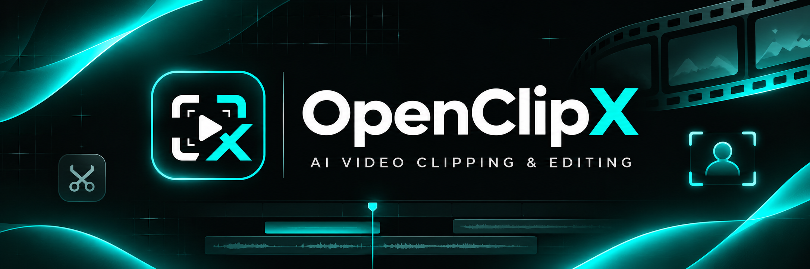
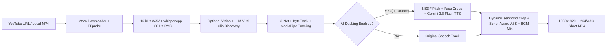

<p align="center">
  
</p>

<h1 align="center"></h1> 

<p align="center">
  <strong>An open-source, ultra-lightweight, self-hosted alternative to <a href="https://openclip.app/">OpenClip</a></strong><br />
  Turn long-form videos into dynamically framed <code>9:16</code> vertical Shorts with active-speaker tracking, animated <code>libass</code> captions, and multi-speaker AI dubbing — built to run smoothly even <strong>under 1.5 GB RAM</strong>.
</p>

<p align="center">
  
  
  
  
  
  
  
</p>

> **Original Inspiration:** [OpenClip (`https://openclip.app/`)](https://openclip.app/)  
> **Release:** `v1.0.0` — Self-hosted core clipping, dynamic framing, and multi-speaker AI dubbing studio. Upcoming releases will bring more OpenClip features, deeper customizations, and expanded export workflows to **OpenClipX**—and **pull requests are always welcome!**

---

## Table of Contents

- [Output Examples](#output-examples)
- [Why OpenClipX?](#why-openclipx)
- [Features in v1.0.0](#features-in-v100)
- [Architecture & Under 1.5 GB RAM Engineering](#architecture--under-15-gb-ram-engineering)
- [Tech Stack](#tech-stack)
- [Prerequisites](#prerequisites)
- [Quick Start](#quick-start)
- [Configuration](#configuration)
- [Running, Testing & Benchmarking](#running-testing--benchmarking)
- [Roadmap & Contributing (PRs Welcome)](#roadmap--contributing-prs-welcome)
- [Responsible Use](#responsible-use)

---

## Output Examples

Real `1080×1920` (`9:16`, 24 fps H.264 + AAC) Shorts generated locally by **OpenClipX**:

| English Original · Dynamic Reframing & Captions | Hindi AI-Dubbed · Multi-Speaker TTS + Devanagari Subtitles |
| :---: | :---: |
| <video src="https://www.image2url.com/r2/default/videos/1794419111104-12b370de-1a53-460d-8868-e46e2386898d.mp4" controls width="280"></video><br />[**Watch / Download MP4 (32.6 MB · 59.8s)**](https://www.image2url.com/r2/default/videos/1794419111104-12b370de-1a53-460d-8868-e46e2386898d.mp4) | <video src="https://www.image2url.com/r2/default/videos/1794419169315-c697a08f-708d-4a72-bc56-ebeba124d7ba.mp4" controls width="280"></video><br />[**Watch / Download Hindi Dubbed MP4 (15.1 MB · 37.4s)**](https://www.image2url.com/r2/default/videos/1794419169315-c697a08f-708d-4a72-bc56-ebeba124d7ba.mp4) |
| Active-speaker tracking with automatic `dual_split` (2 speakers) ↔ `single` (`9:16`) switching and word-highlighted `libass` captions. | Translated from English to **Hindi (`hi`)** with acoustic + visual gender detection, `gemini-3.8-flash-tts` multi-speaker voices, and `Noto Sans Devanagari` subtitles. |

---

## Why OpenClipX?

[OpenClip](https://openclip.app/) makes it effortless to turn podcasts, interviews, talks, and streams into viral short-form videos. **OpenClipX** is built as an **open-source, ultra-lightweight, self-hosted alternative** you can run on a modest laptop or budget VPS—without Docker bloat, Redis/MongoDB daemons, or cloud lock-in.

- **Ultra-Lightweight (Runs Even Under 1.5 GB RAM):** Typical footprint stays around ~150–450 MB RSS, with subprocess isolation and a 4-tier adaptive memory guard keeping peak usage under **1.5 GB RAM** even on 4K inputs.
- **Zero External Infrastructure:** Runs entirely on Node's built-in `node:sqlite` (WAL mode) and an in-process FIFO job queue.
- **Local-First Speech & Vision:** Quantized `whisper.cpp` transcribes locally on CPU, OpenCV **YuNet** + **MediaPipe FaceLandmarker** track active speakers cleanly, and McLeod NSDF estimates vocal pitch (`f0 Hz`) locally with NumPy.
- **Optional Cloud AI & Multi-Speaker Dubbing:** Works offline with local heuristics when no key is set, plugs into any OpenAI-compatible API (`AI_BASE_URL` / `AI_API_KEY`) for viral scoring, vision context, and translation, and uses **`gemini-3.8-flash-tts`** (`GEMINI_API_KEY`) for multi-speaker voice dubbing.

---

## Features in v1.0.0

- **YouTube & Local Video Ingestion:** Fast YouTube format preview and H.264-preferring adaptive download via [`Ytora`](https://github.com/CycloneAddons/ytora), plus local video file support.
- **Memory-Bounded Transcription & RMS Energy:** Silence-chunked quantized `whisper.cpp` (`base-q5_1` or `tiny.en-q5_1`) with word-level timestamps and a 20 Hz audio energy envelope.
- **Hybrid Viral Clip Discovery:** 7-dimension weighted scoring (`hookStrength`, `storyCompleteness`, `emotionalImpact`, `informationValue`, `audienceInterest`, `endingPayoff`, `visualQuality`), optional sampled keyframe (`<= 512px`) vision context, sentence-boundary snapping, and overlap deduplication.
- **Dynamic `9:16` Reframing with Mid-Clip Layout Switching (`smart` mode):**
  - Renders stacked **top/bottom `1080×960` `dual_split`** panels when two speakers converse, then seamlessly switches inside the **same clip** to **full `1080×1920` `single`** when cutting to one speaker—or lock to explicit `single` / `dual` framing.
  - Critically-damped smooth tracking powered by YuNet, ByteTrack-style ID association, scene-cut resets, and MediaPipe inner-lip mouth activity + audio energy fusion.
- **Multi-Speaker AI Dubbing (`gemini-3.8-flash-tts`):**
  - Dubs **English-source** videos into **17 target languages**: Spanish (`es`), Hindi (`hi`), French (`fr`), German (`de`), Portuguese (`pt`), Italian (`it`), Japanese (`ja`), Korean (`ko`), Chinese Mandarin (`zh`), Arabic (`ar`), Russian (`ru`), Indonesian (`id`), Turkish (`tr`), Dutch (`nl`), Polish (`pl`), Vietnamese (`vi`), and Thai (`th`).
  - **3-Signal Male / Female & Distinct Voice Assignment:** Fuses McLeod NSDF `f0` pitch estimation (`cv/analyze_voice_pitch.py`), padded face crop vision inspection, and LLM diarization to pick distinct voices across **37 Male** and **33 Female** prebuilt Gemini voices—with manual Gender & Voice overrides in the Video Editor.
  - Supports 1-speaker (`voiceConfig`), 2-speaker (`multiSpeakerVoiceConfig`, `mode: 'VERBATIM'`), and 3+ speaker dialogues (auto-batched into `<= 2`-speaker blocks) with silence trimming, capped `atempo` timing alignment, BGM mixing, and cancellable `429 RetryInfo` backoff.
- **Animated Word-Level Subtitles (`libass`):** 6 presets (`modern`, `minimal`, `bold`, `podcast`, `gaming`, `educational`), word-by-word color/scale highlights, dynamic split-seam / face-safe positioning, and automatic script-aware **Noto Sans** fonts + space-less CJK chunking.
- **AMOLED Black Studio Web UI:** Pure `#000000` theme with `#00e8f5` cyan accents, per-stage progress bars + toggleable logs drawer, compact scored clip cards, live RAM telemetry, and an interactive Video Editor with real-time face/crop canvas visualization, trim sliders, BGM upload/mixing, and custom export quality/FPS (`24`/`30`/`60`).

---

## Architecture & Under 1.5 GB RAM Engineering



1. **Sequential Single-Job Queue:** Processes one pipeline or clip render at a time using `node:sqlite`, preventing broker overhead and parallel encoder spikes.
2. **Ephemeral Python Subprocesses:** Transcription, face tracking, and pitch analysis run in short-lived workers that exit cleanly after each stage so 100% of native memory returns to the OS.
3. **Single-Pass `sendcmd` Rendering & Disk-Backed Mixing:** Compiles camera crops into compact FFmpeg `sendcmd` scripts and mixes dubbed blocks on disk rather than holding raw video/audio buffers in RAM.
4. **4-Tier Adaptive Memory Pressure Guard:** Continuously samples `/proc/<pid>/status` and `/proc/meminfo` to scale threads, CV width, FPS, and optional vision calls dynamically:

| Pressure Tier | Trigger (`totalAppRssMb` / `systemAvailableMb`) | FFmpeg Threads | CV Width | CV FPS (Base / Boost) | MediaPipe & Cloud Vision |
| :--- | :--- | :---: | :---: | :---: | :---: |
| `NORMAL` | `< 900 MB` & `>= 700 MB` free | Configured (`2`) | `640px` | `5 / 12` | Enabled |
| `ELEVATED` | `>= 900 MB` or `< 700 MB` free | `<= 2` | `<= 480px` | `5 / <= 10` | Enabled |
| `HIGH` | `>= 1500 MB` or `< 420 MB` free | `1` | `426px` | `4 / 8` | Disabled |
| `CRITICAL` | `>= 1700 MB` or `< 220 MB` free | `1` | `320px` | `3 / 6` | Disabled |

---

## Tech Stack

| Layer | Technologies |
| :--- | :--- |
| **Backend & Pipeline** | Node.js `22+`, TypeScript, Express `5`, Zod, Helmet, `node:sqlite`, `openai`, `@google/genai`, `mime`, `ytora` |
| **Frontend Studio** | React `19`, Vite `7`, Tailwind CSS `v4`, React Router `7`, Lucide Icons |
| **Speech, Vision & Audio Workers** | Python `3.10+`, `pywhispercpp` (`whisper.cpp`), OpenCV, MediaPipe, NumPy |
| **Media Engine** | FFmpeg & FFprobe (`libx264`, `aac`, `libass`, `sendcmd`, `silenceremove`, `atempo`, `amix`) |

---

## Prerequisites

- **Node.js `22.13+`** (or `22.5+` for built-in `node:sqlite`) and **npm**
- **Python `3.10+`** with `venv` and `pip`
- **FFmpeg & FFprobe** on `PATH` (with `libx264`, `aac`, and `libass` / `ass` filter support), or set via `FFMPEG_PATH` / `FFPROBE_PATH`
- **Noto Fonts (recommended on Linux for non-Latin captions):** e.g., `fonts-noto` / `fonts-noto-core` and `fonts-noto-cjk` for Hindi, Japanese, Korean, Chinese, Arabic, and Thai subtitles
- *(Optional)* **OpenAI-compatible API key** (`AI_BASE_URL` / `AI_API_KEY`) for LLM clip discovery, vision context, and dub translation
- *(Optional)* **Google Gemini API key** (`GEMINI_API_KEY`) enabling multi-speaker AI dubbing via `gemini-3.8-flash-tts`

---

## Quick Start

### 1. Clone the Repository

```bash
git clone <your-openclipx-repo-url>
cd ClipForge
```

### 2. Install Node.js Dependencies

```bash
npm --prefix backend install
npm --prefix frontend install
```

### 3. Set Up Python Environment & Lightweight Local Models

```bash
python3 -m venv cv/.venv
./cv/.venv/bin/pip install numpy opencv-contrib-python opencv-python-headless mediapipe pywhispercpp
./cv/.venv/bin/python cv/download_models.py --models-dir models
```

Downloads ~61 MB total with default `base-q5_1` (`face_detection_yunet_2023mar.onnx`, `face_landmarker.task`, and `ggml-base-q5_1.bin`).  
For an even smaller **English-only** Whisper model (~31 MB), pass `--whisper-model tiny.en-q5_1` and set `WHISPER_MODEL=tiny.en-q5_1` in `.env`.

### 4. Configure Environment Variables

```bash
cp .env.example .env
```

Edit `.env` to add your optional `AI_BASE_URL` / `AI_API_KEY` and `GEMINI_API_KEY` (required for AI dubbing).

---

## Configuration

All settings are configured via `.env` (see [`.env.example`](.env.example)):

| Variable | Default | Description |
| :--- | :--- | :--- |
| `PORT` | `4000` | HTTP server port (API + built frontend) |
| `NODE_ENV` | `development` | Environment mode (`development` / `production`) |
| `LOG_LEVEL` | `info` | Logging verbosity (`debug` / `info` / `warn` / `error`) |
| `DATA_DIR` | `./data` | SQLite database, uploaded BGM audio, and project workspaces |
| `MODELS_DIR` | `./models` | Whisper, YuNet, and MediaPipe model directory |
| `AI_BASE_URL` | `https://antigravity-reversed.vercel.app/v1` | OpenAI-compatible base URL for LLM, vision, & translation calls |
| `AI_API_KEY` | *(empty)* | API key; falls back to local heuristics if empty |
| `AI_MODEL` | *(auto)* | Optional text model override (auto-detected if blank) |
| `AI_VISION_MODEL` | *(auto)* | Optional vision model override (auto-detected if blank) |
| `GEMINI_API_KEY` | *(empty)* | Gemini API key enabling multi-speaker AI dubbing (`gemini-3.8-flash-tts`) + vision/text fallbacks |
| `GEMINI_TTS_MODEL` | `gemini-3.8-flash-tts` | Gemini TTS model used for `v1beta` voice synthesis |
| `MAX_CONCURRENT_JOBS` | `1` | Maximum concurrent pipeline/render jobs |
| `NORMAL_RAM_TARGET_MB` | `900` | Threshold entering `ELEVATED` memory pressure |
| `PEAK_RAM_BUDGET_MB` | `1500` | Threshold entering `HIGH` memory pressure |
| `EMERGENCY_RAM_CEILING_MB` | `1700` | Threshold entering `CRITICAL` memory pressure |
| `FFMPEG_THREADS` | `2` | Default FFmpeg threads under `NORMAL` memory pressure |
| `CV_ANALYSIS_WIDTH` | `640` | Downscaled frame width for face tracking |
| `CV_BASE_FPS` | `5` | Base face-detection FPS when subjects are steady |
| `CV_BOOST_FPS` | `12` | Boosted face-detection FPS during motion or scene cuts |
| `WHISPER_MODEL` | `base-q5_1` | Default `whisper.cpp` quantized model (`base-q5_1` or `tiny.en-q5_1`) |
| `WHISPER_THREADS` | `2` | CPU threads allocated to `whisper.cpp` |
| `PYTHON_BIN` | `cv/.venv/bin/python` | Optional explicit Python interpreter path |
| `FFMPEG_PATH` | *(auto)* | Optional explicit `ffmpeg` binary path |
| `FFPROBE_PATH` | *(auto)* | Optional explicit `ffprobe` binary path |

---

## Running, Testing & Benchmarking

### Development Mode

Run backend (`http://localhost:4000`) and Vite frontend (`http://localhost:5173`) in separate terminals:

```bash
npm run dev:backend
npm run dev:frontend
```

### Production Build & Start

```bash
npm run build
npm start
```

Open `http://localhost:4000` in your browser.

### Typecheck, Tests & 4K RAM Benchmark

```bash
npm --prefix backend run typecheck
npm --prefix backend run test:unit   # Fast unit tests
npm test                             # Full unit, downloader, HTTP API & E2E tests
npm run benchmark:ram                # Build first: synthetic 4K memory & pipeline benchmark
```

---

## Roadmap & Contributing (PRs Welcome)

**OpenClipX `v1.0.0`** lays down the lightweight `< 1.5 GB RAM` engine, dynamic `dual_split` ↔ `single` framing, word-highlighted subtitles, and multi-speaker Gemini TTS dubbing. Next releases plan to bring even more features from [OpenClip](https://openclip.app/)—and deeper creator customizations—into OpenClipX:

- **Any-to-Any Language Dubbing:** Expand multi-speaker AI dubbing beyond English sources so videos in any Whisper language can be dubbed into any target language.
- **Direct Browser Video Upload:** Drag-and-drop MP4/MKV/MOV uploads in the New Project page.
- **Batch, Playlist & Channel Queues:** Queue multiple videos sequentially within the memory-capped job runner.
- **Inline Word-Level Transcript & Caption Studio:** Click-to-edit transcript words, filler-word removal, custom `.ttf`/`.otf` fonts, and extra kinetic/emoji caption styles.
- **More Aspect Ratios & Creator Layouts:** `1:1`, `4:5`, gameplay/screen-share split layouts, B-roll overlays, and brand watermarks.
- **Hardware Acceleration:** Optional `NVENC` / `VAAPI` / `VideoToolbox` encoders alongside CPU `libx264`.

### Want to Add or Port a Feature? Open a Pull Request!

If you want to build or pull any feature from OpenClip (or add your own presets, caption styles, layouts, AI providers, languages, UI enhancements, or bug fixes) into **OpenClipX**, **you are very welcome to open a Pull Request!**

1. Fork the repository and create a feature branch (`git checkout -b feat/your-feature`).
2. Keep the `< 1.5 GB RAM` streaming/subprocess philosophy intact when adding heavy media or ML steps.
3. Verify your changes before opening the PR:
   ```bash
   npm --prefix backend run typecheck
   npm run build
   npm --prefix backend run test:unit
   ```
4. Open a Pull Request describing what your feature adds and how to test it.

---

## Responsible Use

Only download, dub, or repurpose video and audio content that you own, created, or have explicit rights and permission to process.
